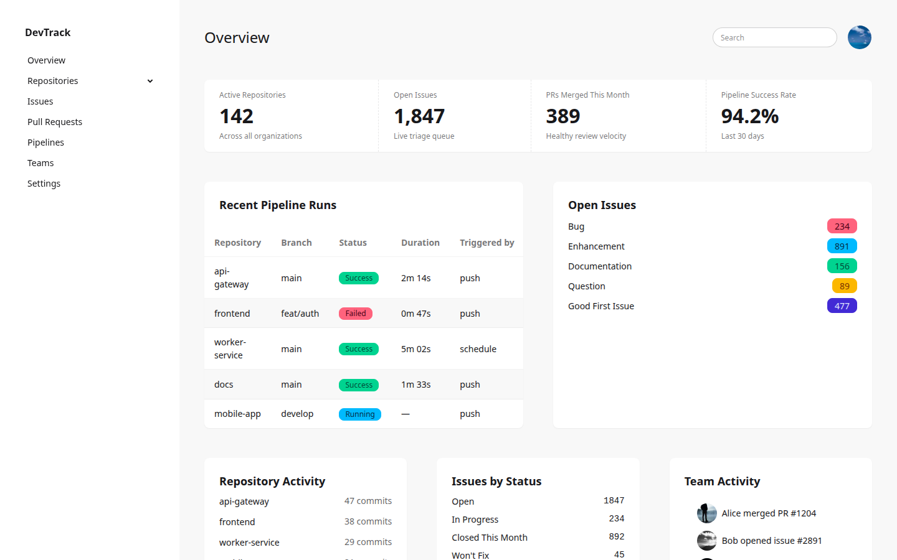

# kdaisyui

[](https://central.sonatype.com/artifact/io.github.ollin.kdaisyui/kdaisyui)

Type-safe [DaisyUI](https://daisyui.com/) components for [kotlinx.html](https://github.com/Kotlin/kotlinx.html).

Write DaisyUI markup in Kotlin with autocompletion, compile-time checks, and zero class-name typos.



```kotlin
createHTML().div {
    daisyCard(extraClasses = "bg-base-100 shadow-xs") {
        daisyCardBody {
            daisyCardTitle("Revenue")
            daisyStats(direction = StatsDirection.Horizontal) {
                daisyStat {
                    daisyStatValue("21,500 USD")
                    daisyStatDesc("21% more than last month")
                }
            }
            daisyButton("View report", color = ButtonColor.Primary)
        }
    }
}
```

## Who is this for?

Kotlin developers building **server-rendered HTML** (with Ktor, Spring, or any JVM framework) who want beautiful, consistent UIs without writing raw CSS class strings.

No frontend build tools required. No JavaScript frameworks. Just Kotlin.

## Documentation

This project follows the [Diátaxis](https://diataxis.fr/) documentation framework:

| | Learn | Work |
|---|---|---|
| **Hands-on** | [Tutorials](docs/tutorials/index.md) — step-by-step lessons | [How-to guides](docs/how-to.md) — solve specific tasks |
| **Theory** | [Explanation](docs/explanation.md) — background concepts | [Reference](docs/reference.md) — complete API |

### Quick links

- **New here?** Start with the [Getting started tutorial](docs/tutorials/getting-started.md)
- **Want to build a real app?** Follow [Build a dashboard with Ktor](docs/tutorials/build-a-dashboard.md)
- **Need a specific recipe?** Check the [How-to guides](docs/how-to.md)
- **Looking up an API?** See the [Component reference](docs/reference.md)
- **Upgrading?** Follow the [upgrade guide](docs/upgrading.md) from your version to the new one

> Published to [Maven Central](https://central.sonatype.com/artifact/io.github.ollin.kdaisyui/kdaisyui). Use the latest version shown on the badge above (or build from source with `just build`).

## Quick start

### 1. Add the dependency

<!-- snippet: skip - a Gradle build script, not code against the library -->
```kotlin
// build.gradle.kts
repositories {
    mavenCentral()
}

dependencies {
    // Import the BOM once (replace VERSION with the latest release), then declare
    // the artifacts without versions — the BOM keeps them aligned.
    implementation(platform("io.github.ollin.kdaisyui:kdaisyui-bom:VERSION"))
    implementation("io.github.ollin.kdaisyui:kdaisyui")
    implementation("io.github.ollin.kdaisyui:kdaisyui-ktor-integration") // optional: Ktor Resources integration
}
```

> **Note:** Released to Maven Central via JReleaser. The latest version is shown on the badge at the top of this README.

**Neither artifact chooses a Ktor version or any web asset for you.** `kdaisyui-ktor-integration`
compiles against Ktor Resources but does not export it: your application owns its Ktor version,
and you add `io.ktor:ktor-server-resources` yourself — an application that uses Ktor Resources has
it already. Its inline functions compile Ktor's own `href` into your code, so a missing module is
a compile error, never a runtime one. It is built and tested against the `ktor` version in
[`gradle/libs.versions.toml`](gradle/libs.versions.toml) at the release tag you depend on.

htmx, Tailwind and the DaisyUI stylesheet are likewise yours to add, at the versions you choose —
see step 3.

### 2. Render your first component

```kotlin
import io.github.ollin.kdaisyui.components.*
import kotlinx.html.div
import kotlinx.html.stream.createHTML

val html = createHTML().div {
    daisyButton("Click me", color = ButtonColor.Primary, size = ButtonSize.Lg)
}
// → <div><button class="btn btn-primary btn-lg">Click me</button></div>
```

### 3. Give those classes some CSS

**kdaisyui emits class names. It does not produce CSS.** The snippet above renders
`class="btn btn-primary btn-lg"` and nothing more — turning that into a styled button is your
application's job, and there is one detail you cannot guess.

#### The detail: your Tailwind cannot see these class names

Tailwind scans your source files for class names. `btn-primary` is assembled at runtime from
`ButtonColor.Primary`, so it appears in **none** of your files — and the published jar contains
compiled classes, not Kotlin sources. A scan of your project finds nothing, Tailwind emits no rule,
and your button renders unstyled with no error anywhere.

So the library ships the list, and its Gradle plugin narrows it to the components your code
uses. Apply the plugin, at the same version as the library:

<!-- snippet: skip - a Gradle settings script, not code against the library -->
```kotlin
// settings.gradle.kts: the plugin is on Maven Central, not the Gradle Plugin Portal
pluginManagement { repositories { gradlePluginPortal(); mavenCentral() } }
```

<!-- snippet: skip - a Gradle build script, not code against the library -->
```kotlin
// build.gradle.kts
plugins { id("io.github.ollin.kdaisyui") version "VERSION" }

// Whatever compiles your stylesheet runs after the list is written:
tasks.named("yourTailwindTask") { dependsOn("kdaisyuiClasses") }
```

`kdaisyuiClasses` reads your compiled classes and writes `build/kdaisyui/kdaisyui-classes.txt`
with the classes of every component they use. Point Tailwind at it:

```css
/* app.css */
@import "tailwindcss" source(none);
@plugin "daisyui";

@source "./build/kdaisyui/kdaisyui-classes.txt";  /* the components your code uses */
@source "./src/main/kotlin";                       /* what you write yourself */
```

Compile it with the Tailwind CLI, the standalone binary, or a container, whatever suits your
build. `:example-app` applies the plugin and compiles in a container, so the repository needs no
Node; see [`example-app/build.gradle.kts`](example-app/build.gradle.kts).

**What it weighs:** `:example-app` uses 20 of the 66 components, and its stylesheet went from
55 KB to 27 KB gzip (572 KB to 229 KB uncompressed) when it switched to the plugin. When the plugin
is in doubt, because your compiled classes name no kdaisyui component, or name one the library's
map does not know, it writes the full list and says why in the build's log and the file's first
lines. A list that is too long costs bytes; one that is too short leaves a page unstyled with no
error.

Without Gradle, extract the full list from the jar, `kdaisyui-classes.txt`, and source that
instead: every class the library can emit, about 550 KB of CSS. **Do not hand-maintain a shorter
list.** It works until the day someone adds a component and forgets, and the failure is silent.

#### The quick path, and what it costs

For a prototype you can skip the build step and serve DaisyUI's prebuilt stylesheet from its
webjar, through Ktor's Webjars plugin:

<!-- snippet: skip - a Gradle build script, not code against the library -->
```kotlin
// build.gradle.kts — DAISYUI_VERSION: see below
implementation("io.ktor:ktor-server-webjars")
implementation("org.webjars.npm:daisyui:DAISYUI_VERSION")
```

<!-- snippet: in Application -->
```kotlin
install(Webjars)
```

<!-- snippet: in HEAD -->
```kotlin
link { rel = "stylesheet"; href = "/webjars/daisyui/daisyui.css" }
```

Take `DAISYUI_VERSION` from `daisyui` in [`gradle/libs.versions.toml`](gradle/libs.versions.toml)
at the release tag you depend on. That is the version the components were generated from, so
it is the version whose stylesheet has every class they emit; a newer DaisyUI 5 normally does too.

This works and needs no toolchain. **What it cannot do is Tailwind variants of DaisyUI classes,
beyond the five prefixes DaisyUI pre-generates.** Measured against 5.7.17:

| Variant | Works with the prebuilt stylesheet |
|---|---|
| `sm:` `md:` `lg:` `xl:` `hover:` | yes |
| `max-sm:` `max-lg:` `dark:` `focus:` … | **no — the class does nothing, silently** |

So `lg:btn-lg` behaves and `max-sm:card-side` does not, with nothing to tell you apart. If you use
responsive or state variants on DaisyUI classes, compile.

> `extraClasses` takes any class you like, but the same rule applies: it must be visible to *your*
> Tailwind setup. The library cannot account for classes it never sees.

#### Under a strict Content-Security-Policy

kdaisyui's markup works under this policy, with nothing loaded from another host and no inline
script or style:

```text
Content-Security-Policy: default-src 'self'; img-src 'self' data:
```

kdaisyui writes no inline `style`, no event handler and no `data:` URL, and its popovers open
without script. `:example-app` sends this header on every response, and its E2E suite fails any
page that logs a console error, so every page of it is checked in Chromium.

**Why `img-src` allows `data:`:** DaisyUI's own stylesheet draws some components with `data:` SVG
images: the masks of `loading`, `mask-*`, the tail of a `chat` bubble, the arrow of a `tooltip`, a
`mockup` control, and the noise texture of its themes. Under `default-src 'self'` alone the
browser refuses them, and a refused mask makes the element **invisible**: a loading spinner or a
masked avatar simply disappears. A `data:` image is part of the stylesheet that carries it and is
fetched from nowhere; scripts and styles stay at `'self'`.

With Ktor, `ktor-server-default-headers` sends it:

<!-- snippet: skip - needs ktor-server-default-headers, which the library does not depend on -->
```kotlin
install(DefaultHeaders) { header("Content-Security-Policy", "default-src 'self'; img-src 'self' data:") }
```

What your application supplies itself: **an icon of its own origin**. A page that links none
makes the browser ask for `/favicon.ico`, and a 404 there is a console error too.

<!-- snippet: in HEAD -->
```kotlin
link { rel = "icon"; type = "image/svg+xml"; href = "/static/favicon.svg" }
```

## Upgrading

Every release that breaks the API says what to change in the [upgrade guide](docs/upgrading.md).
Read its sections from the version you have up to the one you move to; the
[release notes](https://github.com/ollin/kdaisyui/releases) list everything else.

## Modules

| Module | Description |
|---|---|
| `:lib` | Core library — DSL component wrappers (published as `kdaisyui`) |
| `:ktor-integration` | Ktor Resources integration (published as `kdaisyui-ktor-integration`). Depends on `kdaisyui` only — Ktor and every web asset are yours to add |
| `:bom` | Bill of Materials aligning the two artifact versions (published as `kdaisyui-bom`) |
| `gradle-plugin/` | Gradle plugin `io.github.ollin.kdaisyui`, which narrows the CSS class list to the components a build uses (published as `kdaisyui-gradle-plugin`, Maven Central only) |
| `:example-app` | Ktor + htmx demo dashboard |

## Development environment

Building and testing needs **one JDK, 21 or newer**, and Docker for `./gradlew check`. The
Gradle wrapper downloads Gradle (version in [`gradle/wrapper/gradle-wrapper.properties`](gradle/wrapper/gradle-wrapper.properties)),
and the generated sources are committed, so a clone needs no Node, no npm and no git submodule.
Only `just generate`, regenerating after a DaisyUI or Heroicons bump, needs Node and the
submodules.

```bash
git clone https://github.com/ollin/kdaisyui
cd kdaisyui
just test      # run unit tests
just dev       # start dev server → http://localhost:8080
```

[`.tool-versions`](.tool-versions) is the one pin of the JDK CI runs and of the Node `just generate`
needs; CI reads it directly. `asdf install` or `mise install` installs exactly those versions.

## Requirements

Exact versions are the single source of truth in these files:

| What | Where |
|---|---|
| JDK that runs Gradle | [`.tool-versions`](.tool-versions) |
| Kotlin, kotlinx-html, DaisyUI, Heroicons | [`gradle/libs.versions.toml`](gradle/libs.versions.toml) |
| Ktor and webjars the build and the example app use — not exported to consumers | [`gradle/libs.versions.toml`](gradle/libs.versions.toml) |
| Gradle wrapper | [`gradle/wrapper/gradle-wrapper.properties`](gradle/wrapper/gradle-wrapper.properties) |

## Common tasks

This project uses [`just`](https://just.systems/) as a task runner. Run `just` to list all recipes.

| Command | What it does |
|---|---|
| `just dev` | Start the example app → http://localhost:8080 |
| `just test` | Run library unit tests |
| `just e2e` | Run Playwright E2E tests (server managed automatically) |
| `just test-all` | Run unit tests + E2E tests |
| `just build` | Build all Gradle modules |
| `just clean` | Remove all build artifacts |

`just generate` regenerates the committed sources in `lib/generated` and shows the resulting
diff; it is the only recipe that needs Node and the git submodules. The raw Gradle commands
still work if you prefer them directly.

## AI support

This project ships AI-ready context files so AI tools can work with kdaisyui effectively:

| Audience | File | Purpose |
|---|---|---|
| Contributors (all AI tools) | [`AGENTS.md`](AGENTS.md) | Single source of truth: conventions, codegen, tooling, anti-patterns |
| Claude Code | [`CLAUDE.md`](CLAUDE.md) | Thin pointer to AGENTS.md |
| Library users (any AI) | [`llms.txt`](llms.txt) | The index [llmstxt.org](https://llmstxt.org/) specifies: links to the tutorials, how-to, explanation and every component's reference page, as raw Markdown |
| Library users (any AI) | [`llms-full.txt`](llms-full.txt) | Every component's enums and signatures in one file — generated from the library itself |

If you're using kdaisyui as a dependency and want AI assistance, point your AI tool to
`https://raw.githubusercontent.com/ollin/kdaisyui/main/llms.txt`; it follows the links from there.
A tool that takes one file takes [`llms-full.txt`](llms-full.txt). Both are generated and
drift-checked, so they describe the API that ships.

## License

MIT. See [LICENSE](LICENSE).

## Acknowledgements

[DaisyUI](https://daisyui.com/) by [Pouya Saadeghi](https://github.com/saadeghi) is the reason this library exists — making Tailwind CSS semantic is genuinely great work. See [CREDITS.md](CREDITS.md) for full acknowledgements of all projects this library builds on.
